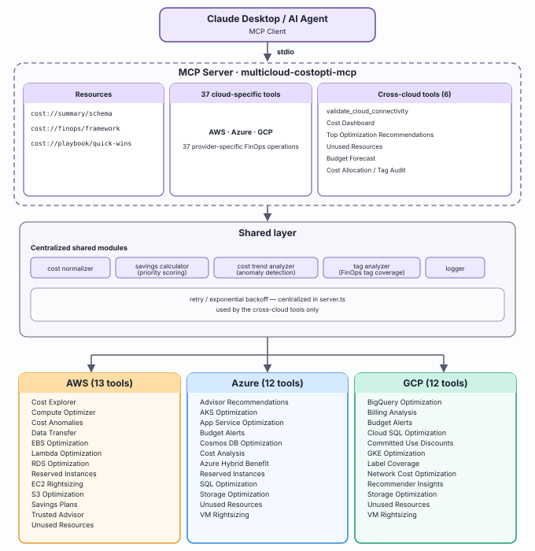

# multicloud-costopti-mcp

> Multi-cloud cost optimization MCP server for AWS, Azure, and GCP, providing unified FinOps visibility, rightsizing, waste detection, and savings recommendations for AI-powered IDEs and agents.

[](https://www.npmjs.com/package/multicloud-costopti-mcp)
[](https://pypi.org/project/multicloud-costopti-mcp/)
[](https://www.typescriptlang.org/)
[](https://modelcontextprotocol.io/)
[](LICENSE)

---

## Overview

A production-grade **Model Context Protocol (MCP) server** that provides **43 cost optimization tools**, **3 MCP resources**, and **4 shared utility modules**: giving AI agents and Claude Desktop unified, read-only visibility into cloud spending across AWS, Azure, and GCP.

Built on the [FinOps Framework](https://www.finops.org/framework/) principles of **Inform**, **Optimize**, and **Operate**, this server enables AI-driven cloud cost management with normalized data types, priority-scored recommendations, and cross-cloud aggregation.

### Key Capabilities

- **Cost Visibility**: Unified cost breakdowns by service, category, region, and account across all three clouds
- **Rightsizing**: EC2, Azure VM, and GCE instance rightsizing based on CPU/memory utilization metrics
- **Waste Detection**: Automated discovery of unused EBS volumes, unattached disks, idle load balancers, orphaned IPs, and stopped VMs
- **Commitment Optimization**: Savings Plans, Reserved Instance, and Committed Use Discount (CUD) purchase recommendations
- **Storage Optimization**: S3 lifecycle policies, gp2-to-gp3 migration, Azure storage tier analysis, GCS Autoclass enablement
- **Container Optimization**: AKS and GKE autoscaler configuration, spot/preemptible node opportunities, Autopilot migration
- **Database Optimization**: RDS/Cloud SQL/Azure SQL idle detection, rightsizing, and serverless migration candidates
- **Budget Monitoring**: Cross-cloud budget status, forecasted overspend alerts, and anomaly detection
- **Tag/Label Auditing**: Resource tagging coverage analysis for proper cost allocation

---

## Architecture



```
src/
├── index.ts                              # CLI entry point (stdio transport)
├── server.ts                             # MCP server factory + 6 cross-cloud tools
├── lib.ts                                # Public API exports for programmatic usage
├── logger.ts                             # Winston logger with account ID masking
├── types/
│   └── cost.ts                          # Core types: NormalizedCostItem, OptimizationRecommendation,
│                                        #   UnusedResource, BudgetStatus, CostTrend, TagCoverage, etc.
├── resources/
│   └── finops-frameworks.ts             # 3 MCP resources: schema, FinOps framework, playbook
└── tools/
    ├── aws/                             # 13 AWS cost optimization tools
    │   ├── cost-explorer.ts             #   Cost breakdown by service/region/account
    │   ├── rightsizing.ts               #   EC2 rightsizing recommendations
    │   ├── savings-plans.ts             #   Savings Plans purchase recommendations
    │   ├── reserved-instances.ts        #   RI purchase recommendations
    │   ├── unused-resources.ts          #   Unattached EBS, unused EIPs, idle NAT GWs, idle ALBs
    │   ├── s3-optimization.ts           #   S3 lifecycle & Intelligent-Tiering
    │   ├── lambda-optimization.ts       #   Lambda memory rightsizing & unused functions
    │   ├── rds-optimization.ts          #   RDS idle/over-provisioned instances
    │   ├── ebs-optimization.ts          #   gp2→gp3 migration, io1/io2 rightsizing
    │   ├── compute-optimizer.ts         #   AWS Compute Optimizer (EC2, Lambda, EBS, ASG)
    │   ├── trusted-advisor.ts           #   Trusted Advisor cost checks
    │   ├── cost-anomalies.ts            #   Cost Anomaly Detection
    │   └── data-transfer.ts             #   Data transfer cost analysis
    ├── azure/                           # 12 Azure cost optimization tools
    │   ├── cost-analysis.ts             #   Cost Management API breakdown
    │   ├── advisor-recommendations.ts   #   Azure Advisor cost recommendations
    │   ├── vm-rightsizing.ts            #   VM CPU utilization analysis
    │   ├── unused-resources.ts          #   Unattached disks, deallocated VMs
    │   ├── storage-optimization.ts      #   Storage tier & redundancy optimization
    │   ├── sql-optimization.ts          #   SQL DTU/vCore & serverless optimization
    │   ├── aks-optimization.ts          #   AKS autoscaler & spot node analysis
    │   ├── reserved-instances.ts        #   Azure RI recommendations
    │   ├── app-service-optimization.ts  #   Empty/over-provisioned App Service Plans
    │   ├── cosmosdb-optimization.ts     #   Cosmos DB RU & region optimization
    │   ├── hybrid-benefit.ts            #   Azure Hybrid Benefit (AHUB) opportunities
    │   └── budget-alerts.ts             #   Budget status & alerts
    ├── gcp/                             # 12 GCP cost optimization tools
    │   ├── billing-analysis.ts          #   BigQuery billing export analysis
    │   ├── recommender.ts               #   GCP Recommender cost insights
    │   ├── vm-rightsizing.ts            #   Compute Engine rightsizing
    │   ├── committed-use.ts             #   CUD recommendations
    │   ├── unused-resources.ts          #   Unattached disks, unused static IPs
    │   ├── storage-optimization.ts      #   GCS lifecycle & Autoclass
    │   ├── bigquery-optimization.ts     #   Expensive queries & partitioning
    │   ├── gke-optimization.ts          #   GKE autoscaler & spot nodes
    │   ├── cloudsql-optimization.ts     #   Cloud SQL HA & rightsizing
    │   ├── network-optimization.ts      #   Egress & inter-region costs
    │   ├── label-coverage.ts            #   Resource labeling audit
    │   └── budget-alerts.ts             #   Billing budget alerts
    └── shared/                          # 4 shared utility modules
        ├── cost-normalizer.ts           #   Normalize cost data across clouds
        ├── savings-calculator.ts        #   Priority scoring (0-100) & savings aggregation
        ├── cost-trend-analyzer.ts       #   Trend detection & anomaly analysis
        └── tag-analyzer.ts              #   Tag/label coverage analysis
```

### Design Patterns

| Pattern | Description |
|---------|-------------|
| **Server Factory** | `createServer(options?)` returns a fully-wired `McpServer`: configurable name, version, and enabled clouds |
| **Tool Registration** | Each tool file exports `register(server)`: validates input with Zod, calls cloud SDK, normalizes response |
| **Unified Types** | All tools return `ToolResponse<T>` with `NormalizedCostItem`, `OptimizationRecommendation`, or `UnusedResource` |
| **Priority Scoring** | `computePriorityScore()` ranks recommendations 0-100 by savings amount, percentage, effort, and type |
| **Retry Strategy** | Exponential backoff with jitter (100ms base, 5 retries, 10s max) on throttling/429 errors |
| **Connectivity Cache** | Cloud credential checks cached for 5 minutes (configurable via `CACHE_TTL_SECONDS`) |
| **Concurrency Control** | `p-limit(3)` for parallel cross-cloud queries |
| **Read-Only** | All tools are read-only, with no modifications to cloud resources |

---

## Quick Start

### Prerequisites

- **Node.js 18+** — [nodejs.org](https://nodejs.org)
- **Python 3.10+** (only if installing via pip)
- Cloud credentials configured for at least one provider (AWS, Azure, or GCP)

### Option 1: npx (recommended)

```bash
npx multicloud-costopti-mcp
```

### Option 2: Global install (npm)

```bash
npm install -g multicloud-costopti-mcp
multicloud-costopti-mcp
```

### Option 3: pip install

```bash
pip install multicloud-costopti-mcp
multicloud-costopti-mcp
```

> **Note:** The Python package is a thin wrapper that delegates to the Node.js server at runtime. Node.js 18+ must be available on PATH.

### Option 4: From source

```bash
git clone https://github.com/skmahe1077/multicloud-costopti-mcp.git
cd multicloud-costopti-mcp
npm install
npm run build
npm start
```

### Development

```bash
npm run dev        # hot reload with tsx watch
npm test           # run tests
npm run typecheck  # type checking only
```

### MCP Client Configuration

<details>
<summary><strong>Claude Desktop</strong></summary>

**Config file path:**

| OS | Path |
|----|------|
| macOS | `~/Library/Application Support/Claude/claude_desktop_config.json` |
| Windows | `%APPDATA%\Claude\claude_desktop_config.json` |
| Linux | `~/.config/claude_desktop_config.json` |

```json
{
  "mcpServers": {
    "multicloud-costopti": {
      "command": "npx",
      "args": ["multicloud-costopti-mcp"],
      "env": {
        "AWS_PROFILE": "cost-reader",
        "AZURE_SUBSCRIPTION_ID": "your-subscription-id",
        "AZURE_TENANT_ID": "your-tenant-id",
        "GCP_PROJECT_ID": "your-project-id",
        "GOOGLE_APPLICATION_CREDENTIALS": "/path/to/service-account.json"
      }
    }
  }
}
```

</details>

<details>
<summary><strong>VS Code (GitHub Copilot)</strong></summary>

**Config file path:**

| OS | Path |
|----|------|
| macOS | `~/Library/Application Support/Code/User/settings.json` |
| Windows | `%APPDATA%\Code\User\settings.json` |
| Linux | `~/.config/Code/User/settings.json` |

Add to your `settings.json`:

```json
{
  "github.copilot.chat.mcp.servers": {
    "multicloud-costopti": {
      "command": "npx",
      "args": ["multicloud-costopti-mcp"],
      "env": {
        "AWS_PROFILE": "cost-reader",
        "AZURE_SUBSCRIPTION_ID": "your-subscription-id",
        "AZURE_TENANT_ID": "your-tenant-id",
        "GCP_PROJECT_ID": "your-project-id",
        "GOOGLE_APPLICATION_CREDENTIALS": "/path/to/service-account.json"
      }
    }
  }
}
```

Or add to your **workspace** `.vscode/settings.json` for project-scoped configuration.

You can also use the `.vscode/mcp.json` file in your workspace root:

```json
{
  "servers": {
    "multicloud-costopti": {
      "command": "npx",
      "args": ["multicloud-costopti-mcp"],
      "env": {
        "AWS_PROFILE": "cost-reader",
        "AZURE_SUBSCRIPTION_ID": "your-subscription-id",
        "AZURE_TENANT_ID": "your-tenant-id",
        "GCP_PROJECT_ID": "your-project-id",
        "GOOGLE_APPLICATION_CREDENTIALS": "/path/to/service-account.json"
      }
    }
  }
}
```

</details>

<details>
<summary><strong>Claude Code (CLI)</strong></summary>

**Config file path:**

| Scope | Path |
|-------|------|
| Global | `~/.claude.json` |
| Project | `.claude/settings.json` (in project root) |

Add via CLI:

```bash
claude mcp add multicloud-costopti -- npx multicloud-costopti-mcp
```

Or manually add to `~/.claude.json`:

```json
{
  "mcpServers": {
    "multicloud-costopti": {
      "command": "npx",
      "args": ["multicloud-costopti-mcp"],
      "env": {
        "AWS_PROFILE": "cost-reader",
        "AZURE_SUBSCRIPTION_ID": "your-subscription-id",
        "AZURE_TENANT_ID": "your-tenant-id",
        "GCP_PROJECT_ID": "your-project-id",
        "GOOGLE_APPLICATION_CREDENTIALS": "/path/to/service-account.json"
      }
    }
  }
}
```

</details>

<details>
<summary><strong>Cursor</strong></summary>

**Config file path:**

| OS | Path |
|----|------|
| macOS | `~/.cursor/mcp.json` |
| Windows | `%USERPROFILE%\.cursor\mcp.json` |
| Linux | `~/.cursor/mcp.json` |

```json
{
  "mcpServers": {
    "multicloud-costopti": {
      "command": "npx",
      "args": ["multicloud-costopti-mcp"],
      "env": {
        "AWS_PROFILE": "cost-reader",
        "AZURE_SUBSCRIPTION_ID": "your-subscription-id",
        "AZURE_TENANT_ID": "your-tenant-id",
        "GCP_PROJECT_ID": "your-project-id",
        "GOOGLE_APPLICATION_CREDENTIALS": "/path/to/service-account.json"
      }
    }
  }
}
```

</details>

<details>
<summary><strong>Windsurf (Codeium)</strong></summary>

**Config file path:**

| OS | Path |
|----|------|
| macOS | `~/.codeium/windsurf/mcp_config.json` |
| Windows | `%USERPROFILE%\.codeium\windsurf\mcp_config.json` |
| Linux | `~/.codeium/windsurf/mcp_config.json` |

```json
{
  "mcpServers": {
    "multicloud-costopti": {
      "command": "npx",
      "args": ["multicloud-costopti-mcp"],
      "env": {
        "AWS_PROFILE": "cost-reader",
        "AZURE_SUBSCRIPTION_ID": "your-subscription-id",
        "AZURE_TENANT_ID": "your-tenant-id",
        "GCP_PROJECT_ID": "your-project-id",
        "GOOGLE_APPLICATION_CREDENTIALS": "/path/to/service-account.json"
      }
    }
  }
}
```

</details>

<details>
<summary><strong>Zed</strong></summary>

**Config file path:**

| OS | Path |
|----|------|
| macOS | `~/.config/zed/settings.json` |
| Linux | `~/.config/zed/settings.json` |

Add to your `settings.json`:

```json
{
  "context_servers": {
    "multicloud-costopti": {
      "command": {
        "path": "npx",
        "args": ["multicloud-costopti-mcp"],
        "env": {
          "AWS_PROFILE": "cost-reader",
          "AZURE_SUBSCRIPTION_ID": "your-subscription-id",
          "AZURE_TENANT_ID": "your-tenant-id",
          "GCP_PROJECT_ID": "your-project-id",
          "GOOGLE_APPLICATION_CREDENTIALS": "/path/to/service-account.json"
        }
      }
    }
  }
}
```

</details>

<details>
<summary><strong>JetBrains IDEs (IntelliJ, WebStorm, PyCharm, etc.)</strong></summary>

**Config file path:**

| OS | Path |
|----|------|
| macOS | `~/Library/Application Support/JetBrains/<IDE><version>/options/mcp.xml` |
| Windows | `%APPDATA%\JetBrains\<IDE><version>\options\mcp.xml` |
| Linux | `~/.config/JetBrains/<IDE><version>/options/mcp.xml` |

> Replace `<IDE><version>` with your IDE name and version, e.g., `IntelliJIdea2025.1`, `WebStorm2025.1`.

Or configure via **Settings > Tools > AI Assistant > MCP Servers**, then add:

- **Name:** `multicloud-costopti`
- **Command:** `npx`
- **Arguments:** `multicloud-costopti-mcp`
- **Environment Variables:** `AWS_PROFILE=cost-reader`, `AZURE_SUBSCRIPTION_ID=your-subscription-id`, etc.

</details>

<details>
<summary><strong>Amazon Q Developer CLI</strong></summary>

**Config file path:**

| OS | Path |
|----|------|
| macOS | `~/.aws/amazonq/mcp.json` |
| Windows | `%USERPROFILE%\.aws\amazonq\mcp.json` |
| Linux | `~/.aws/amazonq/mcp.json` |

```json
{
  "mcpServers": {
    "multicloud-costopti": {
      "command": "npx",
      "args": ["multicloud-costopti-mcp"],
      "env": {
        "AWS_PROFILE": "cost-reader",
        "AZURE_SUBSCRIPTION_ID": "your-subscription-id",
        "AZURE_TENANT_ID": "your-tenant-id",
        "GCP_PROJECT_ID": "your-project-id",
        "GOOGLE_APPLICATION_CREDENTIALS": "/path/to/service-account.json"
      }
    }
  }
}
```

</details>

<details>
<summary><strong>Cline (VS Code Extension)</strong></summary>

**Config file path:**

| OS | Path |
|----|------|
| macOS | `~/Library/Application Support/Code/User/globalStorage/saoudrizwan.claude-dev/settings/cline_mcp_settings.json` |
| Windows | `%APPDATA%\Code\User\globalStorage\saoudrizwan.claude-dev\settings\cline_mcp_settings.json` |
| Linux | `~/.config/Code/User/globalStorage/saoudrizwan.claude-dev/settings/cline_mcp_settings.json` |

```json
{
  "mcpServers": {
    "multicloud-costopti": {
      "command": "npx",
      "args": ["multicloud-costopti-mcp"],
      "env": {
        "AWS_PROFILE": "cost-reader",
        "AZURE_SUBSCRIPTION_ID": "your-subscription-id",
        "AZURE_TENANT_ID": "your-tenant-id",
        "GCP_PROJECT_ID": "your-project-id",
        "GOOGLE_APPLICATION_CREDENTIALS": "/path/to/service-account.json"
      }
    }
  }
}
```

Or configure via: **Cline sidebar > MCP Servers > Configure** in VS Code.

</details>

<details>
<summary><strong>Roo Code (VS Code Extension)</strong></summary>

**Config file path:**

| OS | Path |
|----|------|
| macOS | `~/Library/Application Support/Code/User/globalStorage/rooveterinaryinc.roo-cline/settings/mcp_settings.json` |
| Windows | `%APPDATA%\Code\User\globalStorage\rooveterinaryinc.roo-cline\settings\mcp_settings.json` |
| Linux | `~/.config/Code/User/globalStorage/rooveterinaryinc.roo-cline/settings/mcp_settings.json` |

```json
{
  "mcpServers": {
    "multicloud-costopti": {
      "command": "npx",
      "args": ["multicloud-costopti-mcp"],
      "env": {
        "AWS_PROFILE": "cost-reader",
        "AZURE_SUBSCRIPTION_ID": "your-subscription-id",
        "AZURE_TENANT_ID": "your-tenant-id",
        "GCP_PROJECT_ID": "your-project-id",
        "GOOGLE_APPLICATION_CREDENTIALS": "/path/to/service-account.json"
      }
    }
  }
}
```

</details>

### Config Path Quick Reference

| MCP Client | macOS | Windows | Linux |
|------------|-------|---------|-------|
| **Claude Desktop** | `~/Library/Application Support/Claude/claude_desktop_config.json` | `%APPDATA%\Claude\claude_desktop_config.json` | `~/.config/claude_desktop_config.json` |
| **VS Code (Copilot)** | `~/Library/Application Support/Code/User/settings.json` | `%APPDATA%\Code\User\settings.json` | `~/.config/Code/User/settings.json` |
| **VS Code (Workspace)** | `.vscode/mcp.json` | `.vscode/mcp.json` | `.vscode/mcp.json` |
| **Claude Code** | `~/.claude.json` | `~/.claude.json` | `~/.claude.json` |
| **Cursor** | `~/.cursor/mcp.json` | `%USERPROFILE%\.cursor\mcp.json` | `~/.cursor/mcp.json` |
| **Windsurf** | `~/.codeium/windsurf/mcp_config.json` | `%USERPROFILE%\.codeium\windsurf\mcp_config.json` | `~/.codeium/windsurf/mcp_config.json` |
| **Zed** | `~/.config/zed/settings.json` | N/A | `~/.config/zed/settings.json` |
| **JetBrains** | `~/Library/Application Support/JetBrains/<IDE>/options/mcp.xml` | `%APPDATA%\JetBrains\<IDE>\options\mcp.xml` | `~/.config/JetBrains/<IDE>/options/mcp.xml` |
| **Amazon Q** | `~/.aws/amazonq/mcp.json` | `%USERPROFILE%\.aws\amazonq\mcp.json` | `~/.aws/amazonq/mcp.json` |
| **Cline** | `~/Library/Application Support/Code/User/globalStorage/saoudrizwan.claude-dev/settings/cline_mcp_settings.json` | `%APPDATA%\Code\User\globalStorage\saoudrizwan.claude-dev\settings\cline_mcp_settings.json` | `~/.config/Code/User/globalStorage/saoudrizwan.claude-dev/settings/cline_mcp_settings.json` |
| **Roo Code** | `~/Library/Application Support/Code/User/globalStorage/rooveterinaryinc.roo-cline/settings/mcp_settings.json` | `%APPDATA%\Code\User\globalStorage\rooveterinaryinc.roo-cline\settings\mcp_settings.json` | `~/.config/Code/User/globalStorage/rooveterinaryinc.roo-cline/settings/mcp_settings.json` |

---

## Cloud Credentials

### AWS

```bash
# Option 1: Named profile (recommended)
export AWS_PROFILE=cost-reader

# Option 2: Access keys
export AWS_ACCESS_KEY_ID=AKIA...
export AWS_SECRET_ACCESS_KEY=...
export AWS_DEFAULT_REGION=us-east-1

# Option 3: SSO / assumed role
# Configure via ~/.aws/config
```

**Required IAM permissions:**

```json
{
  "Version": "2012-10-17",
  "Statement": [
    {
      "Effect": "Allow",
      "Action": [
        "ce:GetCostAndUsage",
        "ce:GetRightsizingRecommendation",
        "ce:GetSavingsPlansPurchaseRecommendation",
        "ce:GetReservationPurchaseRecommendation",
        "ce:GetAnomalies",
        "ec2:DescribeVolumes",
        "ec2:DescribeAddresses",
        "ec2:DescribeNatGateways",
        "elasticloadbalancing:DescribeLoadBalancers",
        "elasticloadbalancing:DescribeTargetGroups",
        "elasticloadbalancing:DescribeTargetHealth",
        "s3:ListAllMyBuckets",
        "s3:GetBucketLifecycleConfiguration",
        "lambda:ListFunctions",
        "lambda:GetFunction",
        "rds:DescribeDBInstances",
        "cloudwatch:GetMetricStatistics",
        "compute-optimizer:GetEC2InstanceRecommendations",
        "compute-optimizer:GetLambdaFunctionRecommendations",
        "compute-optimizer:GetEBSVolumeRecommendations",
        "support:DescribeTrustedAdvisorChecks",
        "support:DescribeTrustedAdvisorCheckResult",
        "sts:GetCallerIdentity"
      ],
      "Resource": "*"
    }
  ]
}
```

### Azure

```bash
export AZURE_CLIENT_ID=...
export AZURE_CLIENT_SECRET=...
export AZURE_TENANT_ID=...
export AZURE_SUBSCRIPTION_ID=...
```

**Required roles:**
- `Cost Management Reader`: for cost analysis and budgets
- `Reader`: for resource enumeration and metrics
- `Advisor Reader`: for Advisor recommendations (optional)

### GCP

```bash
export GOOGLE_APPLICATION_CREDENTIALS=/path/to/service-account.json
export GCP_PROJECT_ID=your-project-id
export GCP_BILLING_ACCOUNT_ID=XXXXXX-XXXXXX-XXXXXX
```

**Required roles:**
- `roles/billing.viewer`: billing analysis and budgets
- `roles/compute.viewer`: VM and disk enumeration
- `roles/recommender.viewer`: Recommender insights
- `roles/bigquery.user`: BigQuery billing export queries
- `roles/storage.objectViewer`: GCS bucket analysis
- `roles/container.clusterViewer`: GKE cluster analysis
- `roles/cloudasset.viewer`: label coverage audit
- `roles/cloudsql.viewer`: Cloud SQL analysis

---

## Environment Variables

Copy `.env.example` to `.env` and configure:

```bash
cp .env.example .env
```

| Variable | Default | Description |
|----------|---------|-------------|
| `AWS_PROFILE` | N/A | AWS named profile |
| `AWS_DEFAULT_REGION` | `us-east-1` | Default AWS region |
| `AZURE_SUBSCRIPTION_ID` | N/A | Azure subscription to analyze |
| `GCP_PROJECT_ID` | N/A | GCP project to analyze |
| `GCP_BILLING_ACCOUNT_ID` | N/A | GCP billing account for budget tools |
| `LOG_LEVEL` | `info` | Logging level: `debug`, `info`, `warn`, `error` |
| `LOG_MASK_ACCOUNT_IDS` | `true` | Mask 12-digit account IDs in logs |
| `CACHE_TTL_SECONDS` | `300` | Connectivity cache TTL (seconds) |

---

## Testing

```bash
# Run all 35 tests
npm test

# Watch mode
npm run test:watch

# Type checking only
npm run typecheck
```

**Test suites:**
- `tests/savings-calculator.test.ts`: Priority scoring, impact computation, savings aggregation (12 tests)
- `tests/cost-trend-analyzer.test.ts`: Trend detection, anomaly detection, percent change (15 tests)
- `tests/tag-analyzer.test.ts`: Tag coverage analysis, cross-cloud merging (8 tests)

---

## Programmatic Usage

```typescript
import {
  createServer,
  computePriorityScore,
  aggregateSavings,
  analyzeTrend,
  analyzeTagCoverage,
} from "multicloud-costopti-mcp";

// Create server with specific clouds enabled
const server = createServer({
  name: "my-finops-server",
  version: "1.0.0",
  clouds: ["aws", "azure"],
});

// Use shared utilities independently
const score = computePriorityScore({
  estimatedMonthlySavings: 500,
  savingsPercentage: 40,
  effort: "LOW",
  type: "UNUSED_RESOURCE",
});
// => 75 (high priority: good savings, low effort, quick-win type)

// Analyze cost trends
const trend = analyzeTrend([
  { date: new Date("2024-01-01"), amount: 100, currency: "USD" },
  { date: new Date("2024-02-01"), amount: 150, currency: "USD" },
  { date: new Date("2024-03-01"), amount: 200, currency: "USD" },
]);
// => "INCREASING"
```

---

## Example Prompts for Claude

Once configured in Claude Desktop, try these prompts:

```
"Show me my AWS cost breakdown for the last 30 days"

"Find all unused resources across my AWS and Azure accounts"

"What are my top rightsizing opportunities for EC2 instances?"

"Check if any of my S3 buckets are missing lifecycle policies"

"Analyze my GKE clusters for cost optimization opportunities"

"Should I purchase Savings Plans or Reserved Instances for my EC2 workloads?"

"How many of my Azure VMs are missing Azure Hybrid Benefit?"

"Find BigQuery tables that should be partitioned to reduce scan costs"

"Give me a full FinOps health check across all my cloud accounts"
```

---

## Scripts

| Script | Description |
|--------|-------------|
| `npm run build` | Compile TypeScript to `dist/` |
| `npm start` | Run compiled server (`node dist/index.js`) |
| `npm run dev` | Development mode with hot reload (`tsx watch`) |
| `npm test` | Run test suite (`vitest run`) |
| `npm run test:watch` | Run tests in watch mode |
| `npm run typecheck` | Type check without emitting (`tsc --noEmit`) |
| `npm run lint` | Lint source files |
| `npm run clean` | Remove `dist/` directory |

---

## Related Projects

- [multicloud-security-mcp](https://github.com/skmahe1077/multicloud-security-mcp): Multi-cloud security MCP server with 47 security tools across AWS, Azure, and GCP

---

## License

MIT
